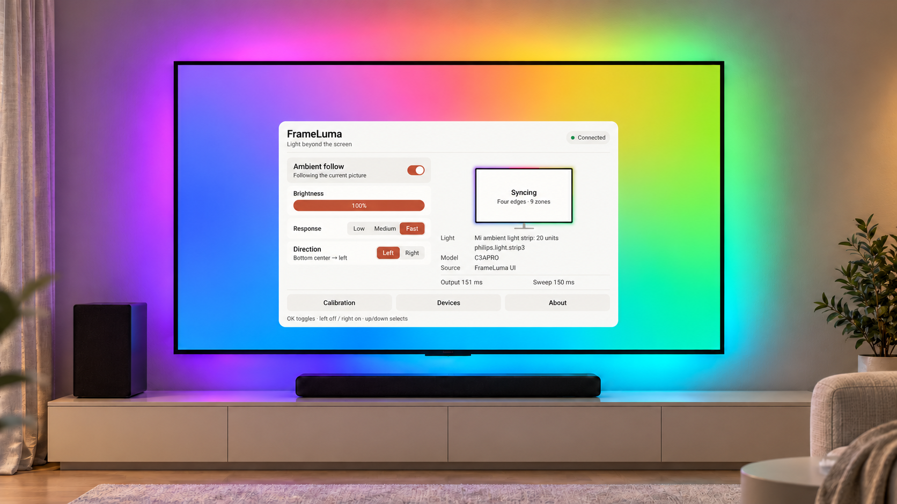
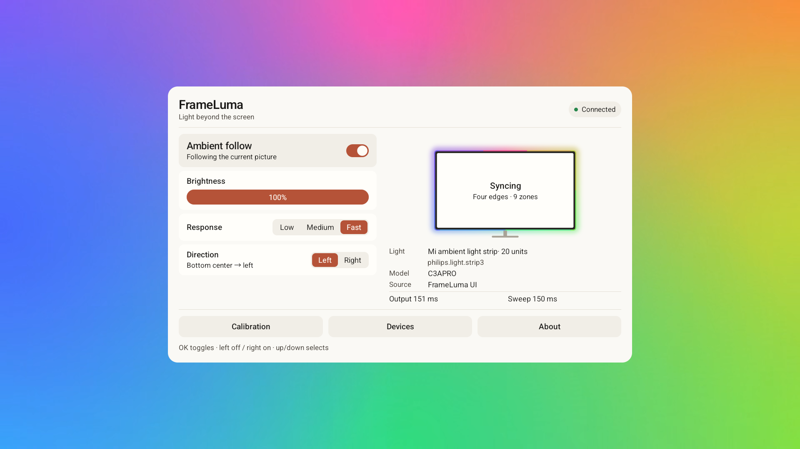
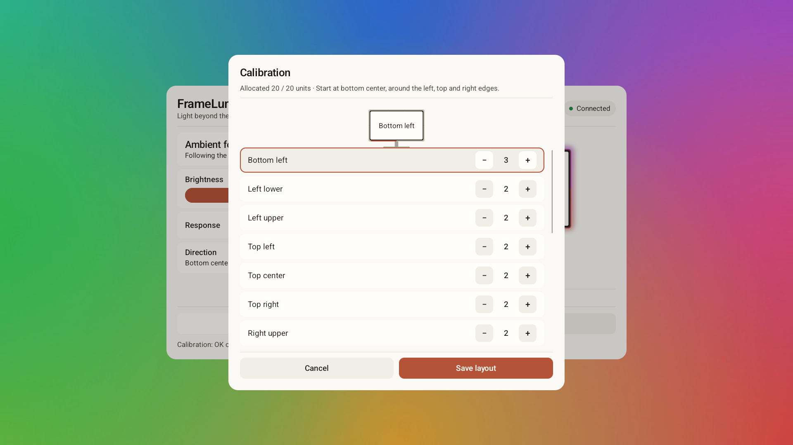
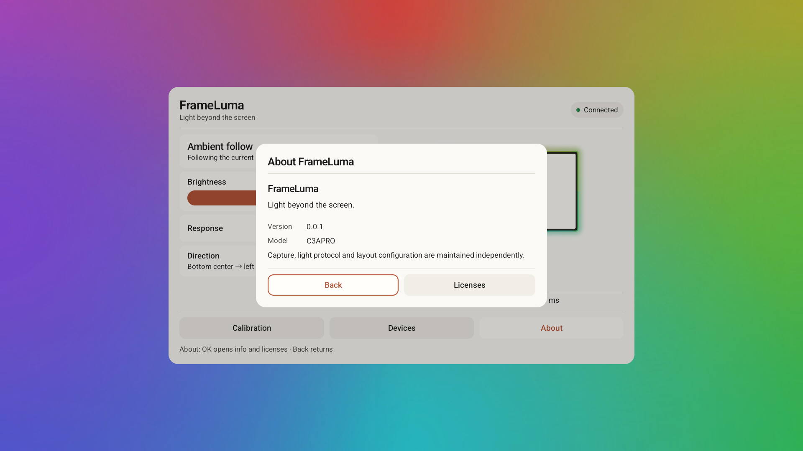

<p align="center">
  
</p>

---

**English** · [简体中文](README.md)

Light beyond the screen. Ambient lighting for Android TVs and smart displays, with independent display, light-controller and layout modules. One APK supports ARM32 and ARM64.



*Enhanced ambient-lighting visualization based on the supplied setup photo, with the English interface.*

## Interface







## Use

Install APK from [Releases](https://github.com/rowanchen-com/frame-luma/releases), connect the USB controller, allow USB access and enable follow. Display interfaces and light controllers are detected automatically; calibration maps the strip to its physical placement.

- Android 9 or newer; each display adapter uses the capture interface provided by the device.
- Package `com.rowanchen.frameluma`.
- Brightness, three response speeds and direction update while running.
- Length comes from the controller; the current layout has nine perimeter zones.
- Compose for TV, system fonts and Chinese/English UI. Up/down moves focus; left/right adjusts values.

## Supported devices

| Display adapter | Capture interface | Background mode |
| --- | --- | --- |
| TCL C3APRO | TTVS host and factory pixel interface | A foreground service maintains the host session |
| Xiaomi MiTV-MFTR0 (freeguy) | TvService | System accessibility binding, with optional automatic recovery |

Automatic discovery uses the available device interfaces, with model names as selection hints. Each adapter keeps one `config.json` alongside its implementation.

Display and light modules can be combined independently. Hardware observations cover a 2 m strip3 on TCL and a 5 m strip3 on Xiaomi. The protocol supports 2/3/4/5 m; 3 m and 4 m have offline coverage only. See [compatibility](docs/compatibility.en.md) for input, HDR and standby coverage. Other devices need the corresponding adapter implementation.

The background plays an original silent loop, with lightweight resources selected automatically on low-memory devices. Xiaomi and TCL keep separate model configurations; the shared performance budget only controls UI cost. Animation duration, light-output speed and preview updates are managed independently. GPU colour fields provide a playback fallback.

## Build

Use JDK 17 and Android SDK 37 / Build Tools 37.0.0. The repository pins the Gradle Wrapper, AGP and Kotlin versions.

```sh
./gradlew :app:exportReleaseApk -x :app:lintVitalRelease -PunsignedBuild=true
```

Use `gradlew.bat` on Windows. The unsigned APK at `.local/dist/frame-luma-unsigned.apk` confirms that the source compiles; sign it before installing on a device. See [build and release](docs/releases.en.md) for signing and Actions. Builds do not connect to devices or increment the version.

## Contribute and report issues

For a new device, start with the [read-only ADB collector](docs/contributing.en.md#collect-device-information-first) and attach its report to a [device-support issue](https://github.com/rowanchen-com/frame-luma/issues/new?template=device.yml). No reverse-engineering experience is required to provide this information. The same guide explains where to add an adapter. Display and light modules communicate through interfaces, so adding a light does not require changing a television adapter.

For issues, include the system model, Android version, controller, input source and reproduction steps. For PRs, describe the behavior before and after the change and the verification actually performed. Mark unverified capabilities clearly; testing every supported device is not required for each PR.

## Project layout

| Directory | Contents |
| --- | --- |
| `app/` | Compose UI, resources and original branding/background |
| `modules/` | Core, runtime, displays, lights, transports and layouts |
| `docs/` | Architecture, compatibility, contribution, release and screenshots |
| `gradle/` | Wrapper, signing and shared build configuration |

[Architecture](docs/architecture.en.md) · [Compatibility](docs/compatibility.en.md) · [Adding adapters](docs/contributing.en.md) · [Releases](docs/releases.en.md)

Thanks to [tv-ambient](https://github.com/Mihaivich/tv-ambient), [aerial-tv](https://github.com/pengchujin/aerial-tv), and [usb-serial-for-android](https://github.com/mik3y/usb-serial-for-android).

[Apache-2.0](LICENSE) · [Required component notices](NOTICE)


