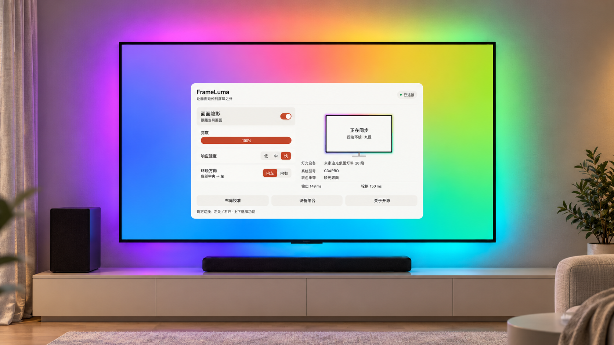
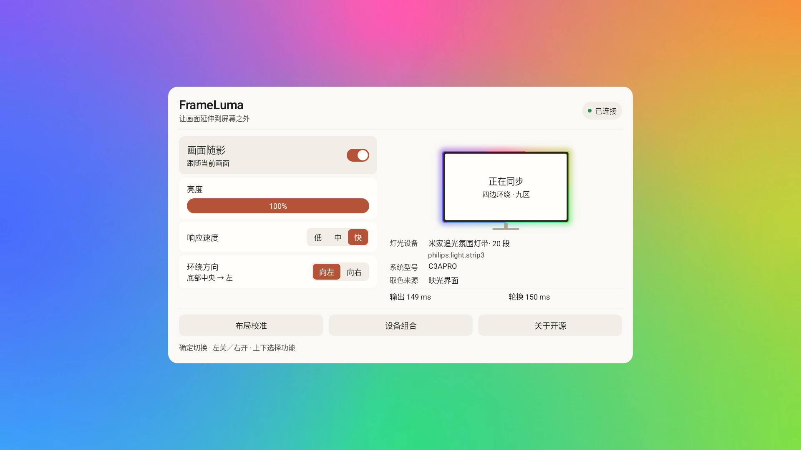
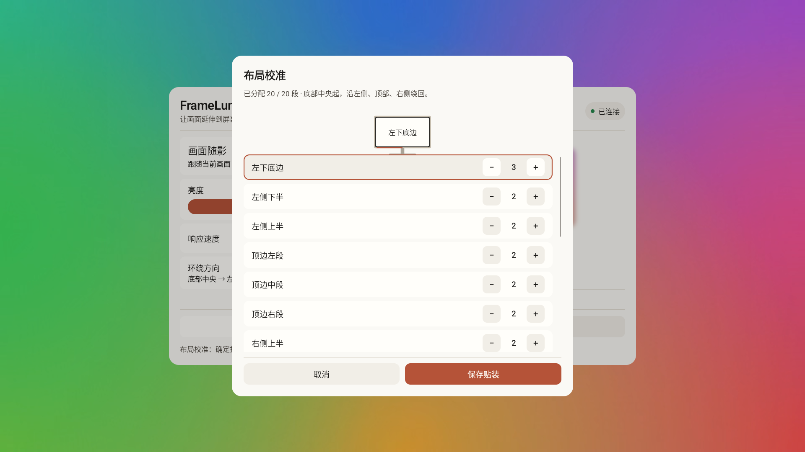
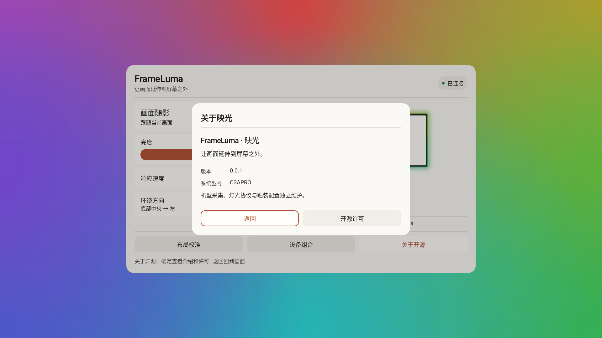

<p align="center">
  
</p>

---

**简体中文** · [English](README.en.md)

让画面延伸到屏幕之外。适用于 Android 电视和智能显示器的随影灯光应用，显示平台、灯光控制盒与贴装布局独立适配，一个 APK 同时支持 ARM32／ARM64。



*基于用户实景优化的幻彩效果展示，采用中文界面。*

## 界面







## 使用

安装 [Release](https://github.com/rowanchen-com/frame-luma/releases) 中的 APK，连接 USB 灯光控制盒，允许 USB 访问，然后开启“画面随影”。显示接口和控制盒自动识别；布局校准用于调整真实贴装位置。

- Android 9 起可安装；取色由显示适配调用设备提供的接口。
- 包名 `com.rowanchen.frameluma`。
- 亮度、低／中／快响应速度、环绕方向支持在线调整。
- 灯带长度由控制盒读取；当前使用四边九区布局。
- 界面使用 Compose for TV、系统字体、中英双语；遥控上下移动，左右直接调值。

## 当前适配

| 显示适配 | 取色接口 | 后台方式 |
| --- | --- | --- |
| TCL C3APRO | TTVS宿主与factory像素接口 | 前台服务维持宿主会话 |
| 小米 MiTV-MFTR0（freeguy） | TvService | 无障碍系统绑定，可选自动恢复 |

自动发现依据设备实际接口，系统型号仅作为选择提示。每个适配目录只保留一份`config.json`和职责源码。

显示适配与灯光模块独立组合。目前接过TCL上的2米和小米上的5米strip3实物；strip3协议覆盖2／3／4／5米，3米与4米仅有离线验证。各信号源、HDR与待机的验证范围见[兼容说明](docs/compatibility.md)。其它设备需要对应的适配实现。

背景使用原创静音循环视频，低内存设备自动使用轻量资源。小米与TCL各自保留独立的机型配置，通用性能分档只管理界面开销；颜色流动周期、灯控速度与预览刷新分别管理。播放失败时回退GPU色场。

## 构建

使用 JDK 17 和 Android SDK 37／Build Tools 37.0.0。Gradle Wrapper、AGP和Kotlin版本由仓库配置提供。

```sh
./gradlew :app:exportReleaseApk -x :app:lintVitalRelease -PunsignedBuild=true
```

Windows 使用 `gradlew.bat`。未签名包输出到 `.local/dist/frame-luma-unsigned.apk`，可用于确认源码能够编译；安装到设备前需要签名。签名与 Actions 说明见[构建与发布](docs/releases.md)。构建不会连接电视，版本不会自动递增。

## 贡献与反馈

新设备可以先按[采集指引](docs/contributing.md#先收集设备信息)生成一份只读ADB报告，再提交[设备适配Issue](https://github.com/rowanchen-com/frame-luma/issues/new?template=device.yml)，不必先会反编译。已有实现思路时，再从[贡献指南](docs/contributing.md#选择修改位置)选择对应目录和示例。显示与灯光通过接口连接，新增一种灯带不需要修改电视适配。

反馈问题时说明系统型号、Android版本、控制盒、信号源和复现步骤；提交PR时写清修改前后的行为以及实际完成的验证。未验证的能力保留说明，不需要为了提交PR测试所有设备。

## 目录与文档

| 目录 | 内容 |
| --- | --- |
| `app/` | Compose 界面、资源和原创图标／背景 |
| `modules/` | 核心、运行层、设备、灯光、传输与布局 |
| `docs/` | 架构、兼容范围、贡献、发布和截图 |
| `gradle/` | Wrapper、签名和公共构建配置 |

[架构](docs/architecture.md) · [兼容范围](docs/compatibility.md) · [添加适配](docs/contributing.md) · [构建发布](docs/releases.md)

致谢：[tv-ambient](https://github.com/Mihaivich/tv-ambient)、[aerial-tv](https://github.com/pengchujin/aerial-tv)、[usb-serial-for-android](https://github.com/mik3y/usb-serial-for-android)。

[Apache-2.0](LICENSE) · [所用组件的必要声明](NOTICE)


