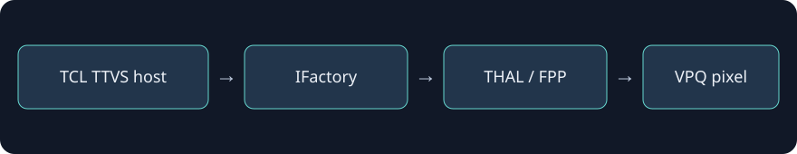

# 识别和取色验证

识别规则必须同时命中品牌TCL、产品M01、设备G10、系统型号C3APRO、hardware rtd2885p、V064及项目ID32。getProjectId的事务27仅按本版本已核对的结构使用，读取失败保持未知；其它固件不能自动套用该事务号。

像素接口是`IFactory.doGetSystemPixelInfo`，经THAL／FPP／VPQ执行硬件采样。模块校验设备上SDK JAR散列，仅在已验证TCL system_app宿主中调用。项目不包含该JAR，也不改变root、SELinux或系统分区。

| 验证项 | 已有依据／当前状态 |
| --- | --- |
| Project32对应27C2A-S | 原机只读项目接口和工程菜单／固件Board映射一致 |
| 固定点DP色块 | 旧原型已读到对应RGB并驱动实物灯带 |
| 新Java回调复用／模块化调用 | v110精确识别Project32，读回正常DP颜色并输出USB；用户确认随影；固定色块回归待做 |
| HDMI1、HDMI2、内置系统、HDR | 待逐源验证，元数据为pending |
| 在线更新／停止／卸载 | v110覆盖加载时宿主与boot标识不变；关闭及强停后采样线程与USB均归零，重新开启恢复；新源码版未卸载测试 |

实机验收应使用已知红／绿／蓝及不同上下边缘色块，记录坐标、原始RGB、当前信号源及实际画面。状态0或全黑不能单独判为成功；测试避免改变工厂模式或信号参数。
