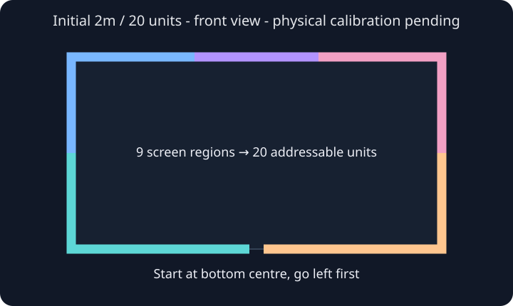

# 长度、帧和资源验证

已验证旧原型使用230400／8N1、PC联动握手和完整颜色帧。新模块迁入本项目自己的Java控制实现，不包含screen_strip_sync的Win32／C++代码。

- RGB颜色和run长度均用十六进制；每run不超过15；所有run必须覆盖完整20单元。
- 纯黑20单元编码为`f + 5`；不能把十进制字符串20当成二十个单元。
- 完整指令含CRLF严格小于120字节；过长明确拒绝，颜色帧不等待ACK，由独立阻塞回包线程检查显式错误；分包行有2048字节上限。
- 会话开始前确认没有外部PC联动占用；结束释放本会话联动和USB。不会为获取设备占用而强制接管接口。
- 其它长度尚未实机验证，检测到3–5m时停止进入随影会话，不照抄公式宣称支持。

离线测试覆盖完整黑帧、1–20段定位、拒绝超长帧和未验证长度、跨包错误及握手完整回包。v110已实机读写，发送耗时约3–4ms，九区分批输出约90ms。实际贴装方向、断连、四输入完整色块与卸载清理仍待单独验证。
