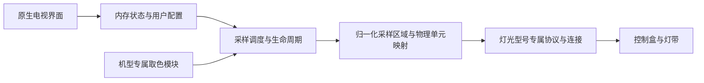
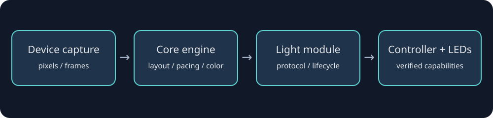

# 架构

## 模型与模块

设备目录不是几份配置的集合。每个型号携带自己的入口类、匹配规则、底层调用、默认配置、测试和文档。`settings.gradle.kts`发现模块，runtime生成类型安全注册表；APK运行时精确选择。品牌使用`tcl-ffalcon`，芯片厂商使用`realtek`／`mediatek`／`amlogic`等完整小写名称。Cortex-A53/A55只属于CPU描述。

TCL首期匹配需要TCL＋M01＋G10＋C3APRO＋rtd2885p＋V064＋Project32；M01/G10/C3APRO不是商品型号的充分条件。项目ID通过已核对的只读服务方法获取，未知值不补猜32。

`PixelSource`支持逐点读取；`FramePixelSource`先取得一帧，再在内存按坐标读取。全帧算法和逐点硬件采样不是同样的性能模型。实际面板坐标与Android界面坐标也分开。

灯光模块负责握手、型号／固件／长度验证、帧约束和释放。核心布局只知道可寻址单元数，不把所有灯带当成20颗或10cm一段。当前Strip3模块只启用已验证2m／20单元，合并长度用十六进制且每run最多15，帧含CRLF小于120字节。

## 运行与资源

普通App负责界面、私有配置和前台服务。TCL机型模块提供当前固件的TTVS宿主接入；它不是root，普通APK也不因此获得系统签名。宿主调用链限定为本包签名、固定操作和当前设备已验证接口，不提供任意命令／文件代理。

沿用已安装原型的字符串引擎ABI。TCL容器的Bootstrap／Controller／清理代码仍放在该机型模块，不把厂商入口放入公共核心。v110已在同一容器进程中覆盖加载，无需重启；卸载行为仍保留为单独的实机验收项。

返回界面保持明确开启的随影；关闭后停止采样并释放USB；强停／卸载清理需经过宿主路径。预览仅在页面可见时跨进程报告，后台不逐帧输出完整日志。配置只在变化时持久化，默认资源缓存后复用；像素数据和状态只在内存。

三个目标周期为150／500／1000ms，实际整轮周期受采样时间限制。逐点后端在流畅档使用`ZoneSampler`：先完整初始化九区，此后每完成三个区域便发送一个完整灯带帧，未采到的区域保留各自上次颜色。帧后端保持同帧输出，不套用跨帧逐点策略。

取色与输出仍由一个采样线程顺序拥有，不排队积累旧帧。Strip3另有一个阻塞USB回包线程，复用128字节缓冲、按行检查错误；停止并等待该线程退出后才执行同步释放命令。握手收到匹配的完整响应即可结束，不再固定等待600ms。像素接口的逐点等待未被消除，27点精细采样仍较慢；参见[性能与边界](performance.md)。
