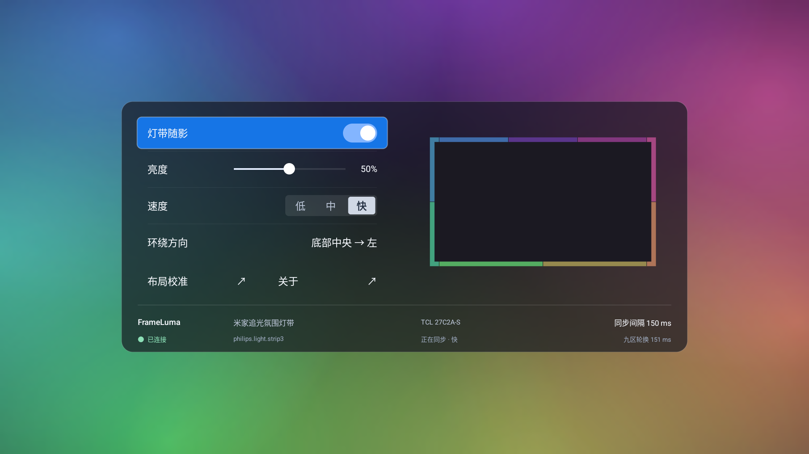

# 主界面与背景随影

截图来自v118的1920×1080逻辑窗口。左侧集中遥控操作，右侧是细九区色框，底部统一显示项目名称、连接状态、控制盒名称／型号、显示器及同步间隔。没有页面Logo、大标题或滚动容器。

视觉参考小米原版的半透明暗面板、清晰遥控焦点，以及tv-ambient的柔光背景和细色框。没有打包小米的背景视频或提取图片；界面、渐变和预览均由本项目的原生代码绘制。

## 窗口适配

`CenteredViewport`按实际可用窗口的宽高计算900×400设计比例，最多使用窗口宽高的70%，保留至少15%的四周空间并居中。控件、字体和预览随同一个比例重新测量，没有把高于窗口的固定dp长列表截断。

1920×1080实机验证了全部主控件位于面板内；1280×720、2560×1440、3840×2160及扣除系统栏的窗口通过同一布局几何测试。2K／4K的这里指布局计算验证，未改动电视的分辨率、密度或显示模式做实机切换。

速度显示为**低／中／快**，对应1000／500／150ms目标周期；显示器逐点采样的整轮下限仍见[性能说明](performance.md)。遥控上下切换控件，左右调节亮度和速度；鼠标／触摸可操作原生开关与亮度滑杆。开关圆钮按短边绘成正圆，不因系统分配非正方形bounds而拉伸。

## 背景和九区预览

七团边缘渐隐的彩色柔光顺时针缓慢移动，色相持续轮换。使用192×108可复用内存位图、预建渐变调色板及矩阵，绘制时不创建新位图／着色器；页面不可见时停止动画。没有硬边彩虹扇面或重复放大折射。

预览中心是不透明深色留空；仅边缘显示实际灯带布局的九个区域。`StripOutline`按型号配置的单元分配计算边框，保留方向、关闭段、偏移和长度。相同颜色也保留区域边界，不用RGB值合并九区。没有发光描边、多层光晕、内部大色块或插值填充；实际发送给灯带的九区取色与映射不随视觉修改而改变。

## App内画面来源

当前TCL硬件逐点接口用于视频画面，不包含映光自身的Android View绘制层。App打开时继续使用这条接口，可能得到黑色或背后视频的颜色。

自身页面可见时，`UiFramePublisher`把自己的View树绘到192×108可复用内存位图，按同一九区布局及采样深度计算颜色。只把九个RGB、布局标识及单调时钟时间放入内存信箱，通过限定调用方的只读接口交给灯光引擎。不会保存截图文件，也不授予录屏、root或存储权限。

页面暂停会清除信箱；画面超过600ms失效。返回DP后引擎自动切回机型硬件后端，重新进入自身页面再使用自身画面。状态中的`capture_source`明确区分`own_app`、`device`及定位测试。该实现只适用于本App，不能据此声明其它内置应用或系统桌面已获得全局取色能力。

自身页面可见时使用窗口级保持唤醒标志，避免预览被屏保覆盖；暂停页面时恢复原标志，不修改系统屏保或休眠设置。绘制和内存采样只在页面可见时运行。

## 验证

v112已由用户现场确认实体灯带跟随App背景；v118已验证自身画面九区颜色持续变化、一个采样线程与一个USB连接，显示器和宿主未重启。v118截图中心区域12684个检查像素全部为预期的留空深色；默认九区边框、反向／关闭段、顺时针轨迹与完整色相范围通过离线测试。

从项目根目录运行`python app/tools/check_main_ui.py --serial <ADB地址>`可只读检查当前主窗口、居中位置、左右分区、底部信息栏及各控件边界。结果及截图保存在电脑`.local/`。当前验证结果见[data/interface-v118.json](data/interface-v118.json)，历史来源切换结果保存在[data/interface-v112.json](data/interface-v112.json)。
